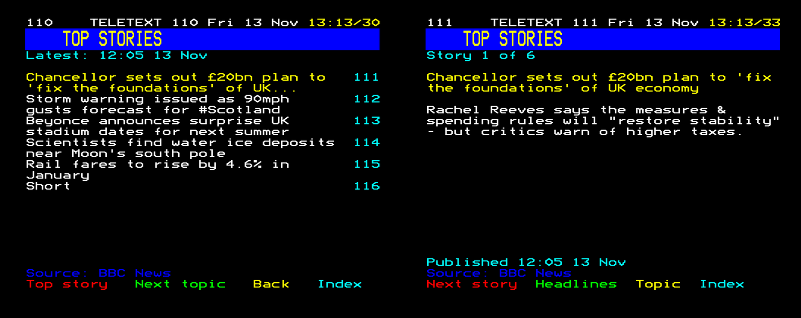

# Teletext Server and Client



**Ready-built Windows programs:** download them from the
[Releases](https://github.com/bartleph/Teletext/releases) page, or build them yourself (below).

A Teletext service for your network. One server holds the pages and any number of
clients (on the same PC or across the LAN) connect to it and browse them like a 1980s TV set.

```
 +-----------------+         TCP port 8023          +------------------+
 |  ttxserver.exe  | <----------------------------> |  ttxclient.exe   |  (many)
 |  console app    |   GET 100  ->                  |  Win32 window    |
 |  pages\*.tti    |   <- PAGE frame (1000 bytes)   |  40 x 25 display |
 |  clock, carousel|   <- HDR every second          |                  |
 +-----------------+                                +------------------+
```

## Folder contents

| File | What it is |
|---|---|
| `server\ttxserver.cpp` | Server source (console application) |
| `server\pages\*.tti` | Demo pages 100-105 (the server recreates these if the folder is empty) |
| `client\ttxclient.cpp` | Client source (Windows GUI application) |
| `client\saa5050.h` | SAA5050 character ROM data, included by the client (keep it in the same folder) |
| `editor\ttxedit.cpp` | Page editor source (Windows GUI application) |
| `editor\saa5050.h` | Same ROM data, for the editor |
| `editor\ttxedit.cfg` | Editor settings: `pagesdir=` (the folder Open/Save start in), `server=`, `password=` |
| `client\ttxclient.cfg` | Client settings: host, port, start page, scaling |
| `server\ttxserver.cfg` | Server settings: port, service name, edit password |
| `feed\ttxfeed.cpp` | News feed program: turns RSS feeds (e.g. BBC News) into pages |
| `feed\ttxfeed.cfg` | Feed settings: which feeds go on which pages |
| `flights\ttxflights.cpp` | Airport arrivals/departures boards from a flight-data API |
| `flights\ttxflights.cfg` | Flights settings: API key, airports, daily request budget |
| `docs\` | Screenshots |

The **server** and **news feed** build on Windows *and* on Linux / Raspberry Pi, so they
can run on a headless machine. The **client** and **editor** are Windows programs that
connect to the server over the network.

## Building in Dev-C++

Each program is a single .cpp file, and each gets its own project.

**Server**
1. File > New > Project > **Console Application**, C++, name it `ttxserver`.
2. Remove the generated `main.cpp` and add `ttxserver.cpp` to the project.
3. Project > Project Options > Parameters > **Linker**: add `-lws2_32`
4. Compile & Run (F11). The first run creates the `pages` folder next to the exe.

**Client**
1. File > New > Project > **Windows Application**, C++, name it `ttxclient`.
2. Remove the generated `main.cpp` and add `ttxclient.cpp`.
3. Project > Project Options > Parameters > **Linker**: add `-lws2_32 -lgdi32`
4. Compile & Run. To test on one PC, start the server first.

**Editor**
1. File > New > Project > **Windows Application**, C++, name it `ttxedit`.
2. Remove the generated `main.cpp` and add `ttxedit.cpp`. Keep `saa5050.h` beside it.
3. Project > Project Options > Parameters > **Linker**: add `-lws2_32 -lgdi32 -lcomdlg32`
4. In `ttxedit.cfg`, set `server=` to your server's address (e.g. `192.168.1.20:8023`) and
   `password=` to its edit password. For local files, set `pagesdir=` too.

**News feed** (only needed if the server runs on Windows)
1. File > New > Project > **Console Application**, C++, name it `ttxfeed`.
2. Add `ttxfeed.cpp`. Linker: `-lwininet`

**Airport boards** (only needed if the server runs on Windows)
1. File > New > Project > **Console Application**, C++, name it `ttxflights`.
2. Add `ttxflights.cpp`. Linker: `-lwininet`

**No projects?** If you just open a .cpp and press Compile, project settings don't apply.
Instead, go to Tools > Compiler Options and tick *"Add the following commands when calling the
linker"*, then enter `-lws2_32 -lgdi32 -lcomdlg32 -lwininet`. Those settings cover all four programs.

All the programs are written in plain C++98, so they should build with the TDM-GCC 4.9 compiler in the original
Dev-C++ as well as the newer Embarcadero Dev-C++.

When you run from Dev-C++, the working folder is the project folder. That's where the
server makes `pages\` and where the client looks for `ttxclient.cfg`.

## Running across the network

* Start `ttxserver.exe`. It prints the addresses clients can use, e.g. `192.168.1.20:8023`.
* On each client PC, set `host=192.168.1.20` in `ttxclient.cfg`, or run
  `ttxclient 192.168.1.20 8023`.
* The first time it runs, Windows Firewall will ask whether to allow the server.
  Tick **Private networks**.
* Options: `ttxserver [port] [service-name]`, e.g. `ttxserver 8023 HOBBYTXT`.
  The service name (up to 8 characters) appears in every header row.

Server console keys: **R** reload pages, **L** list clients, **P** list pages, **Q** quit.
The server also checks the `pages` folder every 2 seconds. When a file is added, changed or
deleted, it reloads and pushes the new version to anyone viewing that page. So you can
save from the editor and watch a client update a moment later.

## Running the server on a headless Linux machine or Raspberry Pi

The server and news feed only need `g++` and `curl`, so they run happily on a Pi.

**1. Copy the files across.** Copy the `server` and `feed` folders to the Pi, for example
into `~/teletext/` (WinSCP works well for this from Windows).

**2. Build** (on the Pi):
```
sudo apt install g++ curl
cd ~/teletext/server && g++ -O2 -o ttxserver ttxserver.cpp
cd ~/teletext/feed   && g++ -O2 -o ttxfeed   ttxfeed.cpp
cd ~/teletext/flights && g++ -O2 -o ttxflights ttxflights.cpp
```

**3. Settings.** In `~/teletext/server/ttxserver.cfg`:
```
port=8023
name=TELETEXT
password=choose-something
```
In `~/teletext/feed/ttxfeed.cfg`, change the first line to `pagesdir=../server/pages`
(forward slashes on Linux).

**4. Try it.** Run `./ttxserver` in the server folder. Type `p` then Enter to list pages,
and `q` then Enter to stop. Point a Windows client at the Pi (`host=` the Pi's address in
`ttxclient.cfg`). `hostname -I` on the Pi shows its address.

**5. Start automatically at boot.** Create `/etc/systemd/system/ttxserver.service`
(change `pi` to your user name and folder):
```
[Unit]
Description=Teletext server
After=network-online.target
Wants=network-online.target

[Service]
User=pi
WorkingDirectory=/home/pi/teletext/server
ExecStart=/home/pi/teletext/server/ttxserver
Restart=always

[Install]
WantedBy=multi-user.target
```
Then make `/etc/systemd/system/ttxfeed.service` the same way, with `Description=Teletext
news feed`, `WorkingDirectory=/home/pi/teletext/feed` and
`ExecStart=/home/pi/teletext/feed/ttxfeed`. Enable both:
```
sudo systemctl daemon-reload
sudo systemctl enable --now ttxserver ttxfeed
journalctl -u ttxserver -f        (watch the log; Ctrl+C to stop watching)
```
If the Pi runs a firewall (`ufw`), open the port: `sudo ufw allow 8023/tcp`.

The server is plain TCP, so keep it on your home network. Don't publish it through your
Cloudflare tunnel without extra protection, because the edit password is sent unencrypted.

## Editing pages on the server (ttxedit)

With `server=` and `password=` set in `ttxedit.cfg`:

* **File > Open from server** (Ctrl+Shift+O). The status bar lists the server's pages.
  Type a page number and press Enter.
* Edit as usual, then press **Ctrl+S**. A page that came from the server is saved back
  to the server, and anyone viewing it sees the change at once.
* **File > Save to server** (Ctrl+Shift+S) sends any page to the server, including a new
  page or one opened from a local file. It is stored as `Pnnn.tti` under its page
  number, so changing the number with Ctrl+P and saving creates a new page.
* **File > Delete page from server** removes a page's `Pnnn.tti` file.

The server only accepts saves and deletes with the right password. With no password set,
anyone on your network can change pages, and the server warns about this when it starts.
Viewing never needs a password.

## News from the internet (ttxfeed)

`ttxfeed` downloads RSS news feeds every 10 minutes and writes them as pages. Each section
gets a headlines page with up to 9 stories, plus one page per story (headline, summary and
time):

| Pages | Section (default `ttxfeed.cfg`) |
|---|---|
| 110, stories 111-119 | BBC News top stories |
| 120 / 130 / 140 / 150 | UK, World, Business, Technology |
| 300, 360 | BBC Sport, Formula 1 |

* The coloured keys work like Ceefax. On a headlines page: red = top story,
  green/yellow = next/previous section, cyan = index (`indexpage=`, default 100). On a
  story: red = next story, green = back to the headlines.
* Add or change sections with `feed=page,TITLE,url` lines. Use a page ending in 0, because
  the next 9 numbers are used for the stories. Most BBC News and Sport pages have a feed at
  the same address on `feeds.bbci.co.uk` with `/rss.xml` on the end, e.g.
  `https://feeds.bbci.co.uk/sport/football/rss.xml`.
* A page is only rewritten when the news changes. If a download fails, the old pages stay.
* Run it on the same machine as the server, with `pagesdir=` pointing at the server's
  `pages` folder. On Linux it downloads with `curl`; on Windows with WinINet.
* Don't edit pages 110-119 and so on by hand: the next update overwrites them. Add links to
  the news sections on your index page (100) with the editor instead.
* The feeds carry headlines and a one-line summary only. The full stories are on the BBC
  website. The pages say "Source: BBC News". This is fine for personal use at home, but
  don't republish the pages publicly.

## Airport arrivals and departures (ttxflights)

`ttxflights` fetches live flight lists from the **MyAirports** API (myairports.online) and
builds Ceefax-style boards:

| Page | Board |
|---|---|
| 410 | Airports index |
| 411 / 412 | Southampton arrivals / departures |
| 413 / 414 | Bristol |
| 415 / 416 | Heathrow |
| 417 / 418 | Gatwick |

* Checked against a real MyAirports reply. Each line shows the time, flight, from/to and status: On time, Exp 14:35, Boarding,
  Gate shut, Lnd 14:31, Dep 14:40, In flight, Cancelled (in red), and so on. Codeshare
  duplicates are left out.
* Busy airports get up to 3 subpages that rotate every 10 seconds.
* The foot of each board shows when MyAirports collected the data ("Flight data from
  14:25"). It can be older than the update time, because MyAirports caches its data.
* Coloured keys: red = the other board for that airport, green/yellow = next/previous
  airport, cyan = index.
* **Setup:** sign up at MyAirports and create an API key (it starts `ma_live_`) in the
  developer dashboard. Put it in `ttxflights.cfg` as `apikey=`, and set `pagesdir=`
  as for ttxfeed. Run it on the same machine as the server.
* **Daily limit:** a free account allows 100 requests a day. Each update costs one request
  per board, so 4 airports use 8. ttxflights keeps count in `ttxflights.state`, which
  survives restarts. It spreads its updates to stay under `budget=` (default 95), only
  between the hours in `hours=` (default 6-23). With 4 airports that is roughly every
  2 hours. Fewer airports or a shorter day means more frequent updates.
* Add or change airports with `airport=CODE,NAME,page` (the arrivals page; departures go
  on the next page). Use the 3-letter IATA airport code.
* Each raw reply is saved as `last_<code>_<type>.json`. If a board stays empty, or the
  console says "none usable", send that file to whoever is maintaining the program so
  the field names can be matched.
* The key is sent as both `Authorization: Bearer` and `X-API-Key`. If MyAirports wants it
  some other way, add `header=` lines (they replace the defaults), e.g.
  `header=x-api-key: {key}`, or put `{key}` in the `url=` line.

## Client keys

| Key | Action |
|---|---|
| 0-9 | Type a three-digit page number (100-899) |
| Up / Down (PgUp / PgDn) | Next / previous page |
| Left / Right | Step through subpages (this stops the carousel for that page) |
| F1 F2 F3 F4 | Fastext red, green, yellow, cyan |
| F5 or I | Index page |
| R | Reveal or hide concealed text |
| H | Hold: freeze the page so the carousel doesn't change it |
| Esc | Cancel a half-typed page number |
| Mouse | Click any 3-digit page number on screen, or a coloured Fastext link |

You can resize or maximise the window. The page always keeps a 4:3 TV shape.
`scaling=smooth` (the default) gives a soft CRT-like edge, and `scaling=sharp` gives
hard-edged pixels.

## Page editor (ttxedit)

The editor shows the page exactly as the client will, using the same SAA5050 font, and
edits it cell by cell, like a real teletext page. Every control code takes up one
character cell. With **View > Show control codes** on (Tab), each code shows as its Esc
letter on a grey square. Text-colour codes show the letter in their colour; graphics-colour
codes show it on a block of their colour. The status bar names the code under the cursor,
e.g. `Code 1D New background (Esc ])`. Codes whose Esc character is `\ ] ^ _` show as
½ → ↑ #, because that is how the UK character set draws those characters.

| Key | Action |
|---|---|
| Typing | Writes at the cursor, then moves right |
| Arrows, Home, End, Enter | Move the cursor |
| Backspace / Del / Ins | Erase the previous cell / delete a cell / insert a space |
| Ctrl+Ins / Ctrl+Del | Insert / delete a whole row |
| F1-F7 | Text colour: red, green, yellow, blue, magenta, cyan, white |
| Shift+F1-F7 | Graphics colour (same order) |
| F8 / Shift+F8 | Flash / steady |
| F9 / Shift+F9 | Double height / normal height |
| F11 / Shift+F11 | New background / black background |
| F12 / Shift+F12 | Separated / contiguous graphics |
| Esc, then a letter | Any code, using the same letters as .tti files (Esc A = red, Esc X = conceal, Esc ^ = hold graphics...) |
| Ctrl+G | **Draw mode**: left mouse button draws mosaic blocks, right button erases. Works in cells to the right of a graphics colour code. In text mode, clicking moves the cursor |
| Tab / Ctrl+R | Show control codes / reveal concealed text |
| PgUp / PgDn | Previous / next subpage (the **Subpage** menu adds, duplicates and deletes them) |
| Ctrl+P | Page settings in the status bar: page number, carousel time, Fastext links, description. Enter moves to the next setting, Esc finishes |
| Ctrl+Z / Ctrl+Y | Undo / redo (up to 200 steps) |
| Ctrl+N / Ctrl+O / Ctrl+S | New / open / save |
| Ctrl+H | Key summary |

The **Insert** menu lists all 31 control codes, in case you forget a key.
`ttxedit P200.tti` opens a file straight away. Ctrl+N starts a blank page and asks for
its number. The first save suggests the name `P200.tti` in your `pagesdir`.

**Typical workflow:** start the server, open a client on the page, edit in ttxedit and
press Ctrl+S. The client shows the change within a couple of seconds.

**Making a banner:** on a row, press F4, F11, then F3 (blue, new background, yellow text),
then type. For a big title, press F9 first to make it double height. Leave the row
below empty, because it is used for the lower half of the tall letters.

**Drawing:** put a graphics colour code at the start of a row (e.g. Shift+F7, white),
press Ctrl+G, then draw. Each character cell is 2×3 blocks. For a coloured background
behind your drawing, use Shift+F4, F11, Shift+F3 (blue, new background, yellow graphics).

## Design

### Server
* **One thread with `select()`.** A single loop waits on the listening socket and all client
  sockets, waking at least 5 times a second. There are no threads, so there are no locking
  problems. The limit is 200 clients, which is plenty for a LAN. (Raise `MAX_CLIENTS` and
  `FD_SETSIZE` together if you need more.)
* **Page store:** `std::map<int, Page>`, keyed by page number (hex, 0x100-0x8FF, as on a real
  service). Each `Page` has a vector of `SubPage`s (25 x 40 bytes), a cycle time, and
  Fastext links.
* **Carousels:** once a second the server moves on any multi-subpage page whose cycle time
  is up, and pushes the new subpage to every client viewing it. Clients that asked for a
  specific subpage are left alone.
* **Header row:** row 0 is never stored. The server builds it live, with the service name,
  page number, date and a yellow clock, and sends it to each client every second.
* **Pages** are loaded from `.tti` files at start-up and when you press R.

### Client
* **Win32 + `WSAAsyncSelect`.** Windows posts a `WM_SOCKET` message to the window when the
  socket connects, has data or closes, so the whole client runs in the normal message loop
  with no threads. If the connection fails or drops, it retries every 5 seconds.
* **Rendering:** no Windows fonts are used. `saa5050.h` holds the character ROM of the
  Mullard SAA5050 teletext chip (96 characters, 5x9 dots in a 6x10 cell). At start-up each
  character is doubled to 12x20 pixels and given the chip's *character rounding*: a
  half-dot is added wherever two dots touch only diagonally. That is what makes real
  teletext text look smooth and chunky. The page is drawn pixel by pixel into a 480x500
  buffer, the SAA5050's own resolution, then stretched to a 4:3 picture with
  `StretchDIBits`. A timer toggles flashing text twice a second.
* **Attribute decoding** follows Level 1 Teletext. "Set-at" codes (steady, normal size,
  conceal, contiguous/separated, black/new background, hold) take effect in their own cell.
  "Set-after" codes (colours, flash, double height, release) take effect from the next cell.
  Mosaic characters are drawn as 2x3 blocks, so they look right with any font.
* The UK character set is used: `#` shows as £, `[` as ←, `\` as ½, and so on.
* Font data: the SAA5050 (UK) bitmap from the *hoard-of-bitfonts* collection
  (github.com/robhagemans/hoard-of-bitfonts), released into the public domain.

### Protocol (TCP, port 8023)

Client to server: one command per line, ending in `\n`.

| Command | Meaning |
|---|---|
| `GET ppp` | Show page ppp (hex digits, e.g. `GET 100`) and follow its carousel |
| `GET ppp s` | Show subpage s (1-based) of page ppp, without rotating |
| `LIST` | Reply `PAGES ppp ppp ...` |
| `GETTTI ppp` | Reply `TTI ppp len` + len bytes: the page as .tti text (for the editor) |
| `AUTH password` | Reply `OK` or `ERR ...`; needed before saving or deleting when a password is set |
| `PUTTTI ppp len` + len bytes | Save the .tti text as `pages/Pppp.tti`. Reply `OK ppp` or `ERR ...` |
| `DELETE ppp` | Delete `pages/Pppp.tti`. Reply `OK ppp` or `ERR ...` |
| `QUIT` | Disconnect |

Server to client: a text line, then fixed-size binary data.

| Message | Followed by |
|---|---|
| `PAGE ppp s n red green yellow cyan index\n` | 1000 bytes: 25 rows x 40 columns, 7-bit Teletext codes. `s`/`n` = subpage / count. Links are hex page numbers, `000` = none |
| `HDR\n` | 40 bytes: a new header row (clock update) |
| `NOPAGE ppp\n` | nothing |

Because the frame sizes are fixed, the client can always tell where one message ends. It
waits until a whole frame has arrived before using it. You could write a client in
anything, even a 6502 with a serial-to-TCP adapter.

## Making your own pages (.tti format)

A `.tti` file is plain text, one command per line:

```
DE,My weather page
CT,10,T               <- seconds per subpage (if more than one)
PN,20000              <- page 200, subpage 00
OL,1,<ESC>M<ESC>CWEATHER
OL,4,<ESC>FSunny spells
PN,20001              <- another subpage of 200: makes a carousel
OL,1,...
FL,100,201,202,203,8FF,100   <- Fastext: red,green,yellow,cyan,(unused),index
```

* `OL,n,` sets row n (1-24). Row 0 is ignored because the server makes its own header.
* Control codes are written as the ESC byte (0x1B) followed by the code + 0x40. For
  example, ESC `A` = alpha red (0x01), ESC `M` = double height (0x0D), ESC `]` = new
  background (0x1D). Codes stored with bit 7 set (0x80-0x9F) are also accepted.
* Several pages can be in one file, or one per file. Drop the files in `pages\` and press
  **R** on the server.
* Teletext editors that save `.tti` files will work. You can also copy and edit the demo
  files.

### Control code reference
| Code | ESC+ | Meaning | | Code | ESC+ | Meaning |
|---|---|---|---|---|---|---|
| 01-07 | A-G | Text red..white | | 11-17 | Q-W | Graphics red..white |
| 08 | H | Flash | | 18 | X | Conceal |
| 09 | I | Steady | | 19 | Y | Contiguous graphics |
| 0C | L | Normal height | | 1A | Z | Separated graphics |
| 0D | M | Double height | | 1C | \ | Black background |
| | | | | 1D | ] | New background |
| | | | | 1E | ^ | Hold graphics |
| | | | | 1F | _ | Release graphics |

Colours: 1 red, 2 green, 3 yellow, 4 blue, 5 magenta, 6 cyan, 7 white.

## Ideas for extending it
* **Live pages:** build a page in code every few seconds (server stats, news from a file
  your scripts update) the same way `MakeHeader` builds row 0.
* **Rolling header:** while a client waits for a page, cycle the header page number like a
  real set searching the carousel.
* **Level 2.5:** extra colours and double width (codes 0x0E, 0x0F) are currently ignored.
